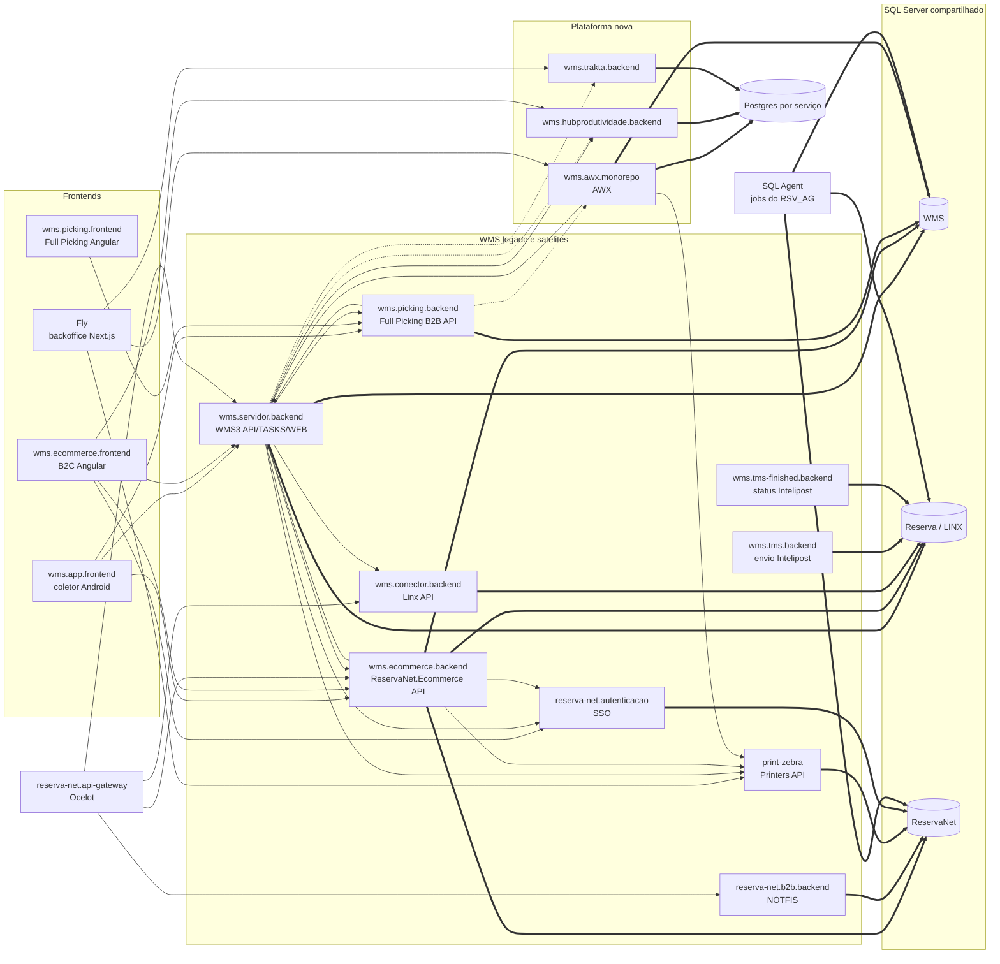

# Mapa de arquitetura cross-repo (SP0)

> **Atualizado em:** 2026-09-24
> **Fonte:** `docs/discovery/edges-consolidado.csv` (2.868 arestas dos 17 discoveries code-only) + `docs/discovery/edges-sqlagent.csv` (1.117 arestas dos jobs do SQL Agent de produção, 2026-09-24, já filtradas pelo escopo)
> **Gerado por:** `python tools/arch-map/build-map.py` (reproduzível; regras de resolução no script)
> **Status:** derivado do código, não validado por pessoa. Repos: banco = catálogo de homologação. Jobs: catálogo e `msdb` de produção. Premissa: todo objeto e job existente em produção conta como usado. **Escopo:** ONDEMAND fora, exceto no banco WMS; procs de fora do WMS/ReservaNet só entram se alcançam um deles (ver "Escopo do banco").

## Como ler

Uma aresta "serviço → serviço" existe quando:

| Via | Critério |
|---|---|
| `http` | o `alvo` de um `http-out` (base URL, chave de config, host) resolve para o repo que expõe aquela API |
| `fila` | um repo publica e outro consome a mesma fila/routing key (DLQ e retry ignorados) |
| `banco` | um repo (ou o nó `sqlagent`, que reúne os jobs do banco) **escreve** num objeto de banco compartilhado (WMS, Reserva, ReservaNet, WMS_Produtividade) que outro lê ou executa |

Arquivos de apoio nesta pasta:

| Arquivo | Conteúdo |
|---|---|
| `servico-servico.csv` | 96 pares origem → destino, com via, nº de arestas e exemplos (12 envolvem `sqlagent`) |
| `objetos-compartilhados.csv` | 130 objetos de banco tocados por 2 ou mais repos (contando `sqlagent` como um), com escritores, leitores e executores |
| `jobs-sqlagent.csv` | um job do SQL Agent no escopo por linha: habilitado, agenda, bancos, nº de objetos escritos/lidos/procs, passos não analisados |
| `procs-escopo.csv` | todas as procs dos 9 bancos de produção com `dentro`/`fora` do escopo e o motivo |
| `filas.csv` | 9 filas com publicadores e consumidores |
| `nao-resolvidos.csv` | saídas HTTP cujo destino não foi identificado (1: URL dinâmica no ecommerce.backend) |
| `mapa.mmd` | diagrama completo gerado (todas as arestas repo→repo e repo→banco) |

## Visão de sistema

Diagrama simplificado (o completo está em `mapa.mmd`). Setas cheias = HTTP; pontilhadas = fila; grossas = escrita em banco.

## Acoplamento por repo

Nº de repos vizinhos (entrada + saída, sem contar externos) e por qual via.

| Repo | Vizinhos | http | banco | fila |
|---|---|---|---|---|
| wms.servidor.backend | 14 | 14 | 11 | 2 |
| wms.ecommerce.backend | 10 | 7 | 10 | — |
| wms.conector.backend | 6 | 2 | 8 | — |
| wms.awx.monorepo | 5 | 3 | 3 | 1 |
| print-zebra.utilitario.backend | 5 | 5 | — | — |
| wms.picking.backend | 5 | 4 | 2 | 1 |
| reserva-net.api-gateway.backend | 4 | 4 | — | — |
| wms.app.frontend | 4 | 4 | — | — |
| wms.ecommerce.frontend | 4 | 4 | — | — |
| wms.tms-finished.backend | 4 | — | 7 | — |
| fly.backoffice.frontend | 3 | 3 | — | — |
| reserva-net.b2b.backend | 3 | 1 | 3 | — |
| reserva-net.autenticacao.monolito | 3 | 3 | 1 | — |
| wms.trakta.backend | 2 | 1 | — | 1 |
| wms.tms.backend | 2 | — | 3 | — |
| wms.hubprodutividade.backend | 2 | 2 | — | 1 |
| wms.picking.frontend | 2 | 3 | — | — |

Leitura: o WMS3 (`servidor.backend`) e o `ecommerce.backend` formam o núcleo. O acoplamento dominante do legado é **por banco**, não por API: 6 repos escrevem em `Reserva.dbo`, e `tms`, `tms-finished` e `conector` se ligam aos demais só por tabelas. A plataforma nova (AWX, hub, trakta) se liga ao legado por filas e por uma ACL que escreve no banco WMS.

## Fluxos HTTP principais

| Origem | Destino | Arestas |
|---|---|---|
| wms.ecommerce.frontend | wms.ecommerce.backend | 92 |
| wms.app.frontend | wms.servidor.backend | 79 |
| wms.ecommerce.frontend | wms.servidor.backend | 73 |
| wms.picking.frontend | wms.picking.backend | 47 |
| wms.ecommerce.backend | wms.servidor.backend | 34 |
| fly.backoffice.frontend | wms.awx.monorepo | 27 |
| wms.servidor.backend | wms.ecommerce.backend | 12 |
| wms.picking.backend | wms.servidor.backend | 10 |
| wms.app.frontend | wms.ecommerce.backend | 7 |
| wms.servidor.backend | print-zebra.utilitario.backend | 6 |

O gateway (`api-gateway`) expõe `/wms`, `/ecommerce`, `/linx` e `/b2b` para os repos correspondentes, mais 6 prefixos sem repo no workspace. Os frontends também chamam os backends direto, sem o gateway.

## Filas

| Fila | Publicador | Consumidor |
|---|---|---|
| `awx_checkout_solicitacao` | wms.picking.backend | wms.awx.monorepo (Checkout) |
| `movimentacao.fisica.realizada` | wms.servidor.backend (outbox) | wms.trakta.backend |
| `wms-atividade_realizada` | wms.servidor.backend | wms.hubprodutividade.backend |
| `wms-sessao_operador_cluster` | wms.servidor.backend | wms.hubprodutividade.backend |
| `faturamento.nota-fiscal.faturar.requested.v1` | wms.awx.monorepo | wms.awx.monorepo (interna) |
| `awx.pedidos-b2c.status-alterado` | wms.awx.monorepo | wms.awx.monorepo (ACL legado) |
| `awx.pedidos-b2c.pedido-criado` | wms.awx.monorepo | sem consumidor no workspace |
| `awx.picking.pedido-b2c-criado` | sem publicador no workspace | wms.awx.monorepo |
| `awx_checkout_volume_expedicao` | sem publicador no workspace | wms.awx.monorepo (ERP Connector) |

## Donos de schema (quem escreve)

| Banco.schema | Repos que escrevem |
|---|---|
| `Reserva.dbo` (LINX) | servidor, ecommerce.backend, conector, b2b, tms, tms-finished, **sqlagent** |
| `WMS.dbo` | servidor, ecommerce.backend, awx (ACL), **sqlagent** (REPA, exportação de NF) |
| `WMS.Recebimento` | servidor, awx (ACL) |
| `WMS.Picking` | picking.backend |
| `WMS.Auditoria`, `WMS.Linx` | servidor |
| `WMS.Produtos`, `WMS.pedido` | awx (ACL) |
| `WMS.checkout` | ecommerce.backend |
| `ReservaNet.ecommerce`, `ReservaNet.checkout` | ecommerce.backend |
| `ReservaNet.sso` | autenticacao.monolito |
| `ReservaNet.b2b`, `ReservaNet.HangFireB2B` | b2b.backend |
| `ReservaNet.infrastructure` | print-zebra |
| `WMS_Produtividade.dbo` | hubprodutividade |
| Postgres por serviço (`pg-*`) | awx (cada serviço o seu), trakta |

## Objetos de banco mais compartilhados

Top 10 de `objetos-compartilhados.csv`:

| Objeto | Repos (sqlagent conta como 1) | Escritores |
|---|---|---|
| `Reserva.dbo.FATURAMENTO_PROD` | 7 | servidor |
| `Reserva.dbo.VENDAS` | 7 | sqlagent, conector, servidor |
| `Reserva.dbo.FATURAMENTO` | 6 | sqlagent, servidor |
| `Reserva.dbo.PRODUTOS` | 5 | — (só leitura) |
| `Reserva.dbo.RSV_ATG_ECOMMERCE_FILA_PEDIDOS_STATUS` | 5 | sqlagent, tms-finished |
| `Reserva.dbo.LX_SEQUENCIAL` | 4 | — (só leitura) |
| `Reserva.dbo.rsv_atg_ecommerce_order_info` | 4 | sqlagent, tms-finished |
| `Reserva.dbo.rsv_atg_ecommerce_shipping_group_info` | 4 | ecommerce |
| `Reserva.dbo.RSV_ATG_ECOMMERCE_SITES` | 4 | ecommerce |
| `Reserva.dbo.VENDAS_PROD_EMBALADO` | 4 | sqlagent, conector, ecommerce, servidor |

O acoplamento por banco vai além do que está no código: procs, views e sinônimos do próprio banco também ligam os schemas (ver a seção "Quem mais toca o meu schema" em cada `tech/integrations.md`).

## Escopo do banco

Decisão do usuário (2026-09-24), aplicada por `tools/db-extract/scope.py`:
- **ONDEMAND fora, exceto no banco WMS.** Todo objeto ou job cujo schema ou nome contém `ondemand` / `on demand` sai do mapa e não serve de caminho para outros objetos. No banco WMS os objetos ONDEMAND (`*PickingProducaoOndemand`, `prECommercePedidoOnDemand*` etc.) ficam, por correção do usuário no mesmo dia. Saíram 198 procs, os 14 jobs ONDEMAND (nenhum toca o WMS), 4 arestas dos repos (ReservaNet.`ondemand.*` e `Reserva.dbo.RSV_ONDEMAND_PEDIDOS_PRODUTO_PRODUCAO`) e o par `api-gateway → ext:OnDemand`. O `edges-consolidado.csv` continua com tudo; o filtro fica no `build-map.py`.
- **Procs, filtro apertado (usuário, 2026-09-24):**
  - procs dos bancos WMS (família WMS, WMSTASKS e WMS_Produtividade) e ReservaNet ficam, fora as ONDEMAND do ReservaNet;
  - procs de outros bancos (Reserva, LinxFranquia, Anymarket...) só ficam se alcançam, direta ou indiretamente, algum objeto do WMS ou do ReservaNet. Tocar só tabelas do LINX que os repos leem (`PRODUTOS`, `FILIAIS`, `PARAMETROS`...) não basta;
  - procs que os repos chamam diretamente ficam, por serem pontos de integração (50 no Reserva, 34 delas sem ligação com WMS ou ReservaNet);
  - procs chamadas diretamente por uma proc do banco WMS (inclusive via sinônimo) ficam: 7 no Reserva, 4 delas só por esta regra (`RSV_FATURAMENTO_AUTOMATICO` e `p_rsv_envia_email`, chamadas por `prREPA`; `P_RSV_ADV_AUTOMATIZA_ENTRADA`; `RSV_ENVIA_EMAIL`);
  - "Indiretamente" = pelo grafo de `sys.sql_expression_dependencies` de produção (proc → proc/view/função → …) e de sinônimos. Triggers disparados por escrita não contam.
- Tabelas e views continuam no mapa quando são do WMS ou citadas pelos repos.
- Nos jobs, ficam só as arestas para esses objetos e as execuções de procs no escopo. Procs fora do escopo não são atravessadas, então o que elas leem e escrevem não conta para o job. Resultado: 401 → 114 jobs no `jobs-sqlagent.csv`, todos com arestas. 12 desses entram só porque chamam as procs de e-mail `RSV_ENVIA_EMAIL` / `p_rsv_envia_email`. Mantidos por decisão do usuário; a regra de "chamada por proc do WMS" vale só para chamadas diretas, sem seguir a cadeia (também decisão do usuário, 2026-09-24).

| Banco | Procs dentro | Procs fora |
|---|---|---|
| WMS | 182 | 0 |
| Reserva | 208 (99 tocam o WMS direto, 2 o ReservaNet direto, 53 indiretamente, 50 chamadas pelos repos, 4 chamadas por procs do WMS) | 3.593 |
| ReservaNet | 39 | 35 (ONDEMAND) |
| Reserva_Integracao_Anymarket | 9 | 6 |
| LinxFranquia | 0 | 1.250 |
| Audit, Ecommerce | 0 | 18 |

## Jobs do SQL Agent

Fonte: `extract/db-prod/_jobs/` (494 jobs, 1.520 passos) cruzado com o catálogo de produção por `python tools/db-extract/jobs-edges.py`. No mapa, todos os jobs formam um só nó, `sqlagent (jobs do banco)`.

Como as arestas são derivadas:
- Só passos TSQL. Os 12 jobs com passos SSIS, CmdExec ou PowerShell foram **todos descartados pelo usuário como fora do escopo** (2026-09-24): `syspolicy_purge_history`, `DBAONL - Coleta Long Running Queries`, `Manutencao_*` (3), `RSV_WFA_INTEGRACAO_SAP`, `RSV_INTEGRACAO_DEPENDENTES`, `RSV_INTEGRACAO_FRANQUIAS`, `RSV_Update_LDB_Franquias`, `RSV_Update_LDB_LOJAS`, `RSV_INTEGRACAO_VENDEDOR_AUXILIAR` e `RSV_ENVIO_MAIL_RESERVADO_RUA_ATRASADO_SUPERVISOR_2022` (lista em `DISCARDED_JOBS`, `jobs-edges.py`). Nenhum tocava WMS ou ReservaNet pelo código.
- Os `EXEC` são seguidos por até 5 níveis de proc, e cada leitura ou escrita dentro deles conta para o job. O detalhe da aresta registra por qual proc passou (`via`).
- Os sinônimos são resolvidos para o objeto base. SQL dinâmico, procs criptografadas e servidores vinculados não são seguidos.
- O passo 1, que para o job quando o nó não é a primária do AG, é ignorado.

Resultado, já com o escopo aplicado: 114 jobs com arestas (774 leituras, 197 escritas, 146 execuções). 35 jobs escrevem algum objeto que um repo também usa, a maior parte nas tabelas centrais do LINX (`FATURAMENTO*`, `VENDAS*`). Para o WMS importam os **14 jobs que escrevem em tabelas do WMS que os repos usam**:

| Job | Agenda | Escreve | Repos afetados |
|---|---|---|---|
| `RSV_ATG_OPERACOES_QUARTO_HORA_ATG_02_01` | a cada 1 min | `WMS.dbo.PickingECommerce`, `ItemProdutoPickingECommerce` | servidor, ecommerce.backend, awx |
| `RSV_EXPORTA_NOTA_FISCAL_WMS3` | a cada 1 min | `WMS.dbo.NotaFiscal`, `Caixa`, `CaixaNotaFiscal` | servidor, picking.backend, awx |
| `RSV_REPA_ECOMMERCE` | a cada 3 h | `WMS.dbo.Picking`, `ItemProdutoPicking`, `PickingDescricao` | servidor |
| `RSV_REPA_OPERACIONAL_2.022`, `_2.023`, `RSV_REPA_QUIOSQUE` | sem agenda (disparo externo) | idem | servidor |
| `p_WMS_LIMPA_ENDERECO_CHECKOUT` | a cada 1 h | `WMS.dbo.MovimentacaoLog` | servidor |
| `WMS_LIMPEZA_CAIXA` | diário 06:00 | `WMS.dbo.MovimentacaoLog` | servidor |
| desabilitados: `RSV_REMOVE_CUP_WMS3` (`WMS.dbo.ItemProduto`), `RSV_REPA_2C`, `_5C`, `_OPERACIONAL`, `_U1U2`, `RSV_REPA_AUTOMATICA_BAW_ECOMMERCE` (tabelas de picking) | | | servidor, ecommerce.backend, picking.backend |

Em outras palavras: os jobs da família REPA chamam `WMS.dbo.prREPAAutomaticaEnderecaProdutoColetor`, que **escreve nas tabelas de picking do WMS**; e `RSV_EXPORTA_NOTA_FISCAL_WMS3` chama `Reserva.dbo.pr_rsv_exporta_nota_fiscal_wms3`, uma proc do LINX que **escreve NF e caixa no WMS a cada minuto**. Nenhum repo mostra essas dependências. O significado de negócio (o que é REPA, por que o LINX grava NF no WMS) é `[unverified]` e vai para a entrevista. Os demais jobs que tocam o WMS (`WMS - vwCrossdocking`, `WMS_PREENCHE_GRIFFE`, `RSV_POPULA_SIGLA_PEDIDO`, `RSV_WMS_FINALIZA_NF` etc.) só escrevem em objetos que nenhum repo cita e aparecem apenas em `edges-sqlagent.csv`.

## Limites deste mapa

- A resolução HTTP é por serviço, não por rota. As regras de casamento estão em `HTTP_RULES` no script; destinos sem repo no workspace aparecem como `ext:` em `servico-servico.csv`.
- Arestas de banco dos repos consideram só objetos citados no código deles. As procs do banco entram apenas quando chamadas por um job (seção "Jobs do SQL Agent"); procs chamadas só por outras procs ou pelos repos, e triggers, continuam fora.
- Fora do workspace e, portanto, sem o outro lado da aresta: Logistica.Integrada.BFF (Helix), OnDemand, os serviços ReservaNet `queries/commands/tasks/smtp/aviamento`, os backends não-WMS do Fly e as APIs de integração do LINX.
- `GET/PUT /api/Configuracoes` do WMS3 faltam no `edges.csv` do servidor.backend.
