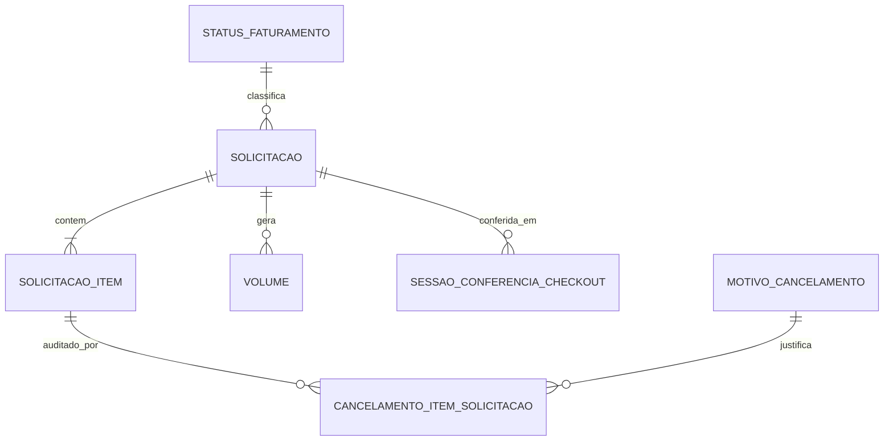
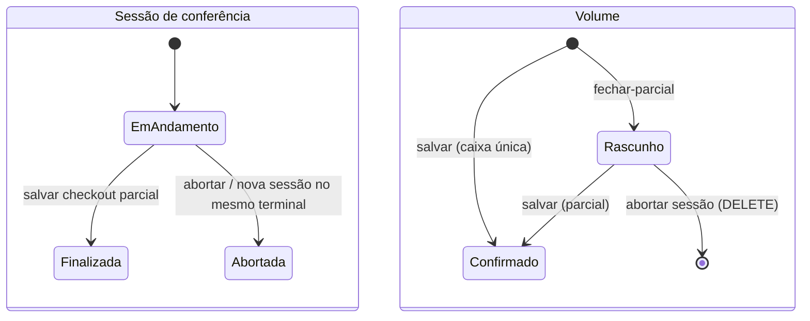

# Modelo da solicitação de checkout

> **Last updated:** 2026-10-06
> **Scope:** Entidades e ciclos de vida do AWX.Checkout (`src/Services/AWX.Checkout`)
> **Mode:** code-only
> **Status:** code-derived, not validated by a person — see ../../_discovery/assumptions-register.md

## Diagrama

## Entidades

| Entidade (tabela) | O que representa | Atributos que importam | Relações |
|---|---|---|---|
| Solicitação (`solicitacao`) | Pedido de checkout vindo da fila | `identificador` (44), `numero_pedido` (12), `nome_cliente`, `codigo_barra_caixa`, `id_armazem`, `operador`, `data_hora_checkout`, `status_faturamento_id` | itens, volumes, sessões |
| Item (`solicitacao_item`) | Peça a conferir | `cup` (14), código de barras, produto, cor, grade, `id_volume` (sem FK), dados de conferência e de cancelamento | solicitação (FK obrigatória) |
| Volume (`volume`) | Caixa montada | `identificador` (gerado pelo WMS legado), `tipo_caixa` (Papelão/Sacola), `tipo_caixa_faturamento` (código Linx), `status`, `id_sessao_conferencia` | solicitação |
| Sessão de conferência (`sessao_conferencia_checkout`) | Conferência feita por um terminal | `id_solicitacao`, `terminal`, `status` | solicitação |
| Cancelamento (`cancelamento_item_solicitacao`) | Auditoria de item cancelado, sempre quantidade 1 | motivo, descrição, usuário | item, motivo |
| Motivo de cancelamento (`motivo_cancelamento`) | 1 Qualidade, 2 Perda da peça, 3 Outros (exige descrição) | — | — |
| Parametrização (`parametrizacoes`, `parametrizacoes_log`) | Modo de fechamento e de faturamento por armazém (PK `id_armazem`) | `realizar_fechamento_parcial_checkout`, `realizar_faturamento_pre_checkout` | — |
| Status de faturamento (`status_faturamento`) | Catálogo 1..6 | — | solicitação (FK, SetNull) |
| Tipo de caixa de faturamento (`faturamento_caixa_tipo`) | 14 códigos do Linx | PK `tipo_caixa` | — |

`Pedido`/`PedidoItem` existem no Core como entidade de teste, sem tabela (C-21).

## Ciclos de vida

O status de faturamento da solicitação segue o catálogo AProcessar=1, EmProcessamento=2, Criada=3, Faturado=4, ErroAoFaturar=5, NaoConfirmado=6. Só o 5 libera um novo checkout (retentativa); as transições reais acontecem no Faturamento ([model-faturamento.md](../faturamento/model-faturamento.md)) (C-22).

Regras que governam essas transições: [rules-checkout-application.md](./rules-checkout-application.md).
