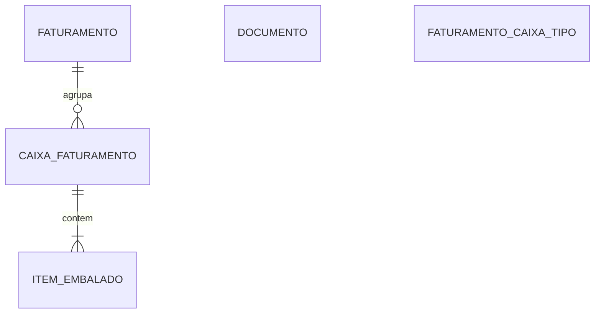
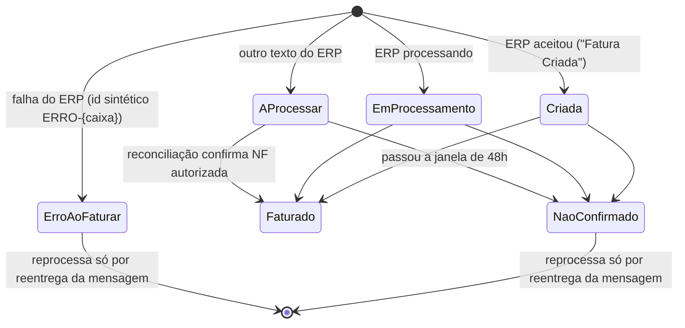

# Modelo do faturamento

> **Last updated:** 2026-10-06
> **Scope:** Entidades e ciclo de vida do AWX.Faturamento (`src/Services/AWX.Faturamento`)
> **Mode:** code-only
> **Status:** code-derived, not validated by a person — see ../../_discovery/assumptions-register.md

## Diagrama

## Entidades

| Entidade (tabela) | O que representa | Atributos que importam | Relações |
|---|---|---|---|
| Faturamento (`faturamento`) | Pedido de NF enviado ao ERP e acompanhado até a autorização | `id_faturamento` (único), `status`, `msg_erro`, `nf_saida`, `filial`, `dentro_do_prazo_cancelamento`, `proxima_verificacao_em`, `tentativas_verificacao` | 1:N caixas (FK na caixa, Restrict) |
| Caixa (`caixa_faturamento`) | Caixa embalada a faturar | `id_solicitacao_checkout`, `caixa` (índice não único), `embalador`, `tipo_caixa`, `armazem`, `data_embalagem` | itens (cascade) |
| Item embalado (`item_embalado`) | Peça da caixa | `pedido`, `cup` (= código de barras), `produto`, `cor`, `quantidade` | caixa |
| Documento (`documento`) | Etiqueta guardada em JSON | PK `chave` (`{CAIXA}_CHECKOUT` / `{CAIXA}_MINIDANFE`), `tipo` (Danfe, Caixa, CheckoutB2B, MiniDanfeB2B), `valor` jsonb | — |
| Tipo de caixa (`faturamento_caixa_tipo`) | Catálogo de 14 códigos, só seed | PK `tipo_caixa` | — |

## Ciclo de vida do faturamento

Numeração base 1 (AProcessar=1 … NaoConfirmado=6), espelhada no Checkout. Só o worker de reconciliação grava `Faturado`, embora o comentário do enum fale em "endpoint dedicado" (C-52).

Regras: [rules-faturamento-application.md](./rules-faturamento-application.md).
