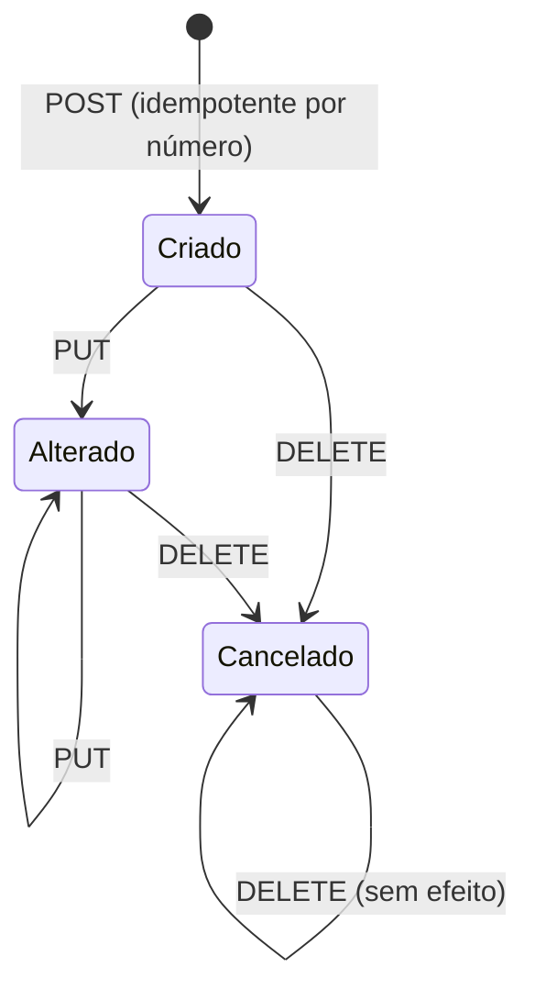

# Modelo do pedido B2C

> **Last updated:** 2026-10-06
> **Scope:** Entidades e ciclo de vida do AWX.PedidosB2C (`src/Services/AWX.PedidosB2C`) e do registro no AWX.Picking
> **Mode:** code-only
> **Status:** code-derived, not validated by a person — see ../../_discovery/assumptions-register.md

## Entidades

| Entidade (tabela) | Serviço | O que representa | Atributos que importam |
|---|---|---|---|
| Pedido (`pedidos`) | PedidosB2C | Pedido de e-commerce | `numero_pedido` (100, único), `seller`, `tipo_pedido`, `armazem` (opcional), `status` |
| Item (`pedido_itens`) | PedidosB2C | Item do pedido | `sku`, `quantidade`, `on_demand`, `ja_foi_on_demand` |
| Evento de outbox (`outbox_eventos`) | PedidosB2C | Evento a publicar | `status` (Pendente, Publicado, Falhou), `ativo`, tentativas |
| Picking e-commerce (`picking_ecommerce`) | Picking | Pedido registrado no picking | `numero_pedido` (50, único), `armazem` (10), `numero_or` (sequence a partir de 53000000), `numero_lote` (sequence a partir de 28000000) |
| Item do picking (`picking_ecommerce_item`) | Picking | Itens | FK cascade |
| Log de consumo (`outbox_eventos`) | Picking | Tentativas de consumo do evento | — |

## Ciclo de vida

Alterar um pedido cancelado dá 409 `Pedido.Cancelado`. Um evento de outbox passa a Falhou e fica inativo depois de 3 falhas (C-72).

Regras e fluxo: [rules-pedido-service.md](./rules-pedido-service.md), [workflow-pedido-b2c.md](../../business/workflow-pedido-b2c.md).
