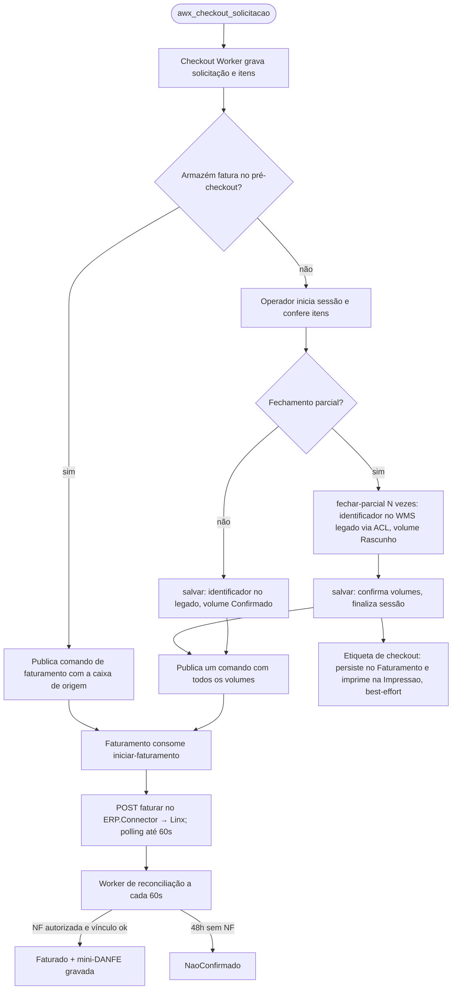

# Do checkout ao faturamento

> **Last updated:** 2026-10-06
> **Scope:** Fluxo que começa na fila `awx_checkout_solicitacao` e termina na NF autorizada e na etiqueta; nome a partir do código, `[unverified]` como fluxo de negócio
> **Mode:** code-only
> **Status:** code-derived, not validated by a person — see ../_discovery/assumptions-register.md

**Atores:** operador de checkout (terminal), Full Picking B2B (produtor), ERP Linx · **Gatilho:** caixa pronta publicada em `awx_checkout_solicitacao` (C-91) · **Resultado:** volumes confirmados, NF autorizada registrada, etiquetas impressas

- **Decisões:** pré ou pós-checkout e parcial ou caixa única vêm da parametrização por armazém; só ErroAoFaturar libera novo salvar (C-23, C-24, C-25) ([rules-checkout-application.md](../areas/checkout/rules-checkout-application.md)).
- **Caminhos de erro:** mensagem inválida vai para `awx_checkout_solicitacao-dlq`; o MassTransit tenta 5s/15s/30s; falha do ERP grava ErroAoFaturar; sem NF em 48h fica NaoConfirmado, sem fluxo automático de saída (C-14, C-54, C-55, A-20).
- **Passagens:** o Checkout não recebe evento de volta e consulta o status no Faturamento por HTTP (por caixa, CUP ou pedido) (C-50). A tela Fly passa pelo BFF (`/checkout/**`, `/faturamento/api/v1/faturamento/status/**`).
- **Tempos:** polling de 12×5s no envio; reconciliação a cada 60s com backoff até 30 min; janela de 48h; atualização de caixa bloqueada com NF há mais de 24h (C-32, C-54, C-55) ([rules-faturamento-application.md](../areas/faturamento/rules-faturamento-application.md)).
- **Volume de expedição:** o ERP.Connector consome `awx_checkout_volume_expedicao` e repassa ao Linx, mas nenhum código do repo publica nessa fila; a constituição diz que o produtor é externo ao monorepo, sem nomeá-lo (A-11).
