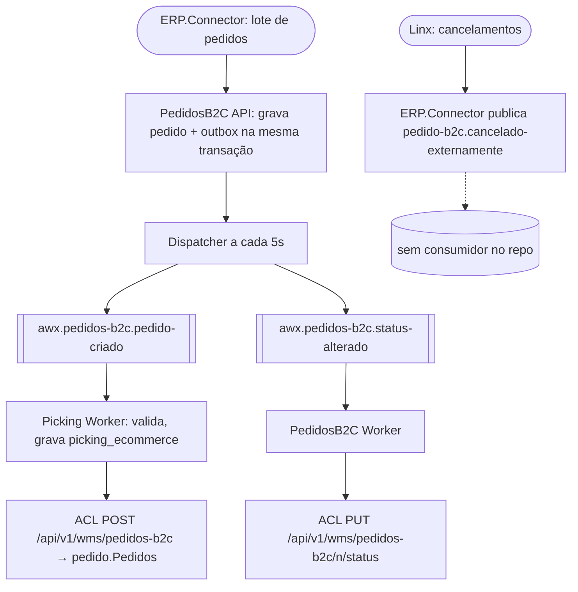

# Pedido B2C até o WMS legado

> **Last updated:** 2026-10-06
> **Scope:** Fluxo de criação, alteração e cancelamento do pedido B2C, do ERP.Connector ao banco do WMS legado; nome a partir do código, `[unverified]` como fluxo de negócio
> **Mode:** code-only
> **Status:** code-derived, not validated by a person — see ../_discovery/assumptions-register.md

**Atores:** ERP Linx (via ERP.Connector) · **Gatilho:** `POST /api/pedidos-b2c/lote` no conector, que chama `POST /api/v1/pedidos-b2c` · **Resultado:** pedido no Postgres do PedidosB2C, picking registrado e projeção `pedido.Pedidos` no legado

- **Decisões:** criação idempotente por número; alteração que informa itens ou armazém reemite `pedido-criado` (o Picking ignora a duplicata local, mas chama a ACL de novo, que também é idempotente) (C-73, C-75, C-49) ([rules-pedido-service.md](../areas/pedidos-b2c/rules-pedido-service.md)).
- **Caminhos de erro:** Picking: validação vai para a DLQ, ACL 400 vai para a DLQ, outros erros fazem retry 10/30/60s. Status: nack com requeue, sem DLQ. Outbox: 3 falhas inativam o evento (C-70, C-74, C-75).
- **Lacunas:** cancelar o pedido não cancela o picking; o evento de cancelamento externo não tem consumidor (A-18); pedido sem armazém é aceito no B2C e rejeitado no Picking (C-69, A-19).
