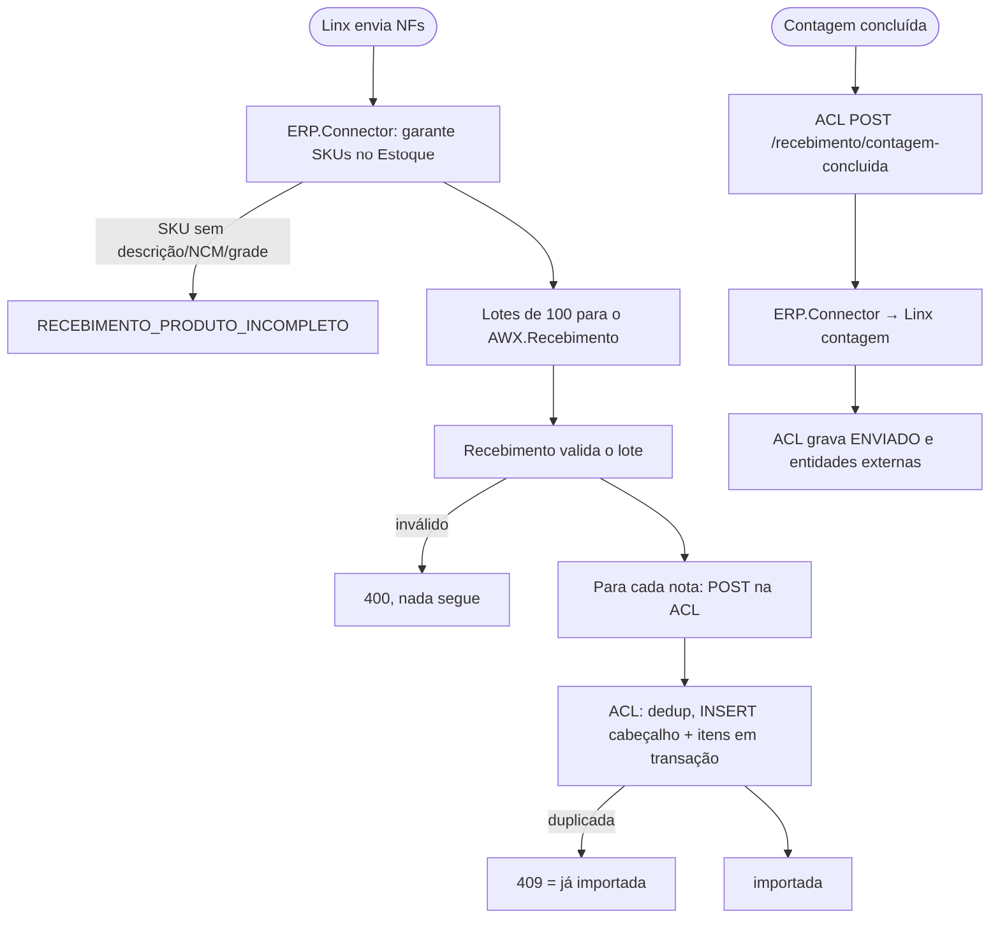

# Recebimento de NF de entrada

> **Last updated:** 2026-10-06
> **Scope:** Fluxo da NF de entrada do Linx até o banco do WMS legado e o retorno da contagem; nome a partir do código, `[unverified]` como fluxo de negócio
> **Mode:** code-only
> **Status:** code-derived, not validated by a person — see ../_discovery/assumptions-register.md

**Atores:** ERP Linx, conferente (contagem, fora do AWX) · **Gatilho:** `POST /api/recebimento/nota-fiscal-entrada/sincronizar` no ERP.Connector · **Resultado:** NF e itens em `Recebimento.NotaFiscal*`; depois da contagem, romaneios de sobra/falta no ERP

- **Decisões:** origem precisa ser Fornecedor, Loja ou CrossDockingRepa; 409 da ACL não é falha (C-47, C-81, C-82; [rules-recebimento-service.md](../areas/recebimento/rules-recebimento-service.md), [rules-integracao-legado-application.md](../areas/integracao-legado/rules-integracao-legado-application.md)).
- **Caminhos de erro:** lote com erro no Recebimento conta todas as notas como falha no conector, que avisa que elas "serão reenviadas"; ACL indisponível vira `RECEBIMENTO_LEGADO_INDISPONIVEL`; falha do ERP na contagem grava FALHA (C-66, C-46).
- **Lacunas:** quem chama a contagem concluída na ACL não aparece no repo; a rota do Recebimento (`importar` × `sincronizar`) depende da URL configurada (A-3).
