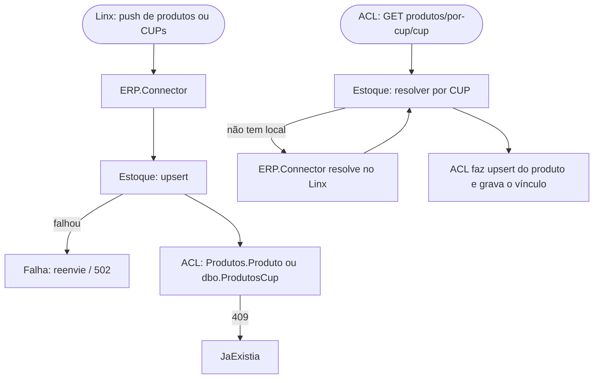

# Sincronização de produtos e CUP

> **Last updated:** 2026-10-06
> **Scope:** Fan-out de produtos e CUP do Linx para o AWX.Estoque e o WMS legado, e a resolução sob demanda; nome a partir do código, `[unverified]` como fluxo de negócio
> **Mode:** code-only
> **Status:** code-derived, not validated by a person — see ../_discovery/assumptions-register.md

**Atores:** ERP Linx · **Gatilho:** push do Linx (`/api/linx/produtos/sync`, `/api/produtos-cup/sync`) ou consulta de um CUP/SKU desconhecido · **Resultado:** produto e vínculo CUP→SKU no Estoque e no legado

- **Ordem:** sempre Estoque primeiro, legado depois; no push de produtos o legado é best-effort, no de CUP o resultado vem por item (C-63, C-64; [rules-erp-connector-application.md](../areas/conector-erp/rules-erp-connector-application.md)).
- **Duplicidade:** CUP já existente conta como JaExistia nos dois lados (C-48, C-63).
- **Dado divergente:** o código de barras gravado na importação do ERP é o próprio SKU (A-17); os limites de tamanho da ACL são menores que os da tabela ([model-produto.md](../areas/estoque/model-produto.md)) (C-60).
