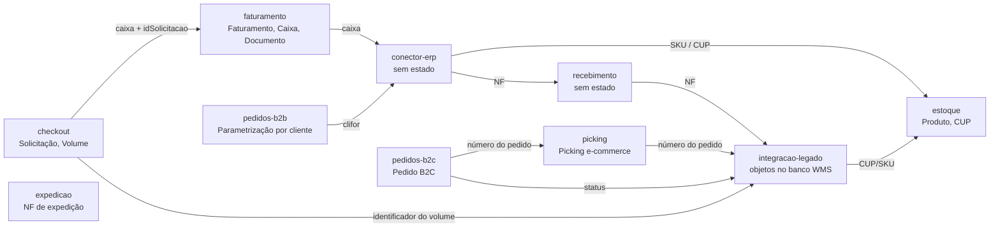

# Modelo de domínio

> **Last updated:** 2026-10-06
> **Scope:** Agregados do AWX, a área dona de cada um e as relações entre áreas (`industria-logistica.wms.awx.monorepo`, commit `e495e61`)
> **Mode:** code-only
> **Status:** code-derived, not validated by a person — see ../_discovery/assumptions-register.md

Não há chave estrangeira entre serviços: cada um tem seu banco, e a ligação entre áreas é por valor (número do pedido, caixa, CUP, SKU, id da solicitação) trafegado em mensagem ou HTTP. Atributos e ciclos de vida ficam nos arquivos `model-*` de cada área.

## Donos e relações entre áreas

| Agregado | Área dona | Onde vive | Referenciado por |
|---|---|---|---|
| Solicitação (itens, volumes, sessões de conferência, cancelamentos) | checkout | `pg-checkout` | faturamento (pelo `x-entity-id` = id da solicitação e pela caixa) |
| Parametrização de checkout por armazém | checkout | `pg-checkout` | — |
| Faturamento (caixas, itens embalados) | faturamento | `pg-faturamento` | checkout (consulta status por caixa, CUP ou pedido) |
| Documento (etiqueta) | faturamento | `pg-faturamento` | checkout (reimpressão) |
| Produto, vínculo CUP→SKU, código de barras→SKU | estoque | `pg-estoque` | conector-erp, integracao-legado |
| Pedido B2C (itens) e outbox | pedidos-b2c | `pg-pedidosb2c` | picking, integracao-legado (projeção `pedido.Pedidos`) |
| Picking e-commerce (itens) | picking | `pg-picking` | — |
| Parametrização por cliente | pedidos-b2b | `pg-pedidosb2b` | — |
| NF de expedição | expedicao | `pg-expedicao` | — |
| NF de entrada, contagem, produto e CUP no legado, projeção de pedido | integracao-legado | banco `WMS` (SQL Server) | recebimento, conector-erp, picking, pedidos-b2c |

Recebimento, conector-erp, relatorios e impressao não guardam estado de negócio (C-3).

## Cópias do mesmo dado em mais de um lugar

- **Status de faturamento** existe no Checkout (`status_faturamento`, seed 1..6) e no Faturamento (`StatusFaturamento`), com a mesma numeração base 1; o Checkout não recebe o status por evento e consulta o Faturamento por HTTP (C-50).
- **Catálogo de tipos de caixa** (14 códigos) é semeado nos dois bancos, Checkout e Faturamento (C-51).
- **Produto e CUP** existem no Estoque (Postgres) e no legado (`Produtos.Produto`, `dbo.ProdutosCup`); o conector grava primeiro no Estoque e depois no legado (C-60).
- **Pedido B2C** é gravado no PedidosB2C (fonte da verdade, segundo o db/README da ACL), no Picking (`picking_ecommerce`) e no legado (`pedido.Pedidos`) (C-71).

Modelos por área: [checkout](../areas/checkout/model-solicitacao.md), [faturamento](../areas/faturamento/model-faturamento.md), [pedidos-b2c](../areas/pedidos-b2c/model-pedido-b2c.md), [estoque](../areas/estoque/model-produto.md), [integracao-legado](../areas/integracao-legado/model-objetos-legado.md).
