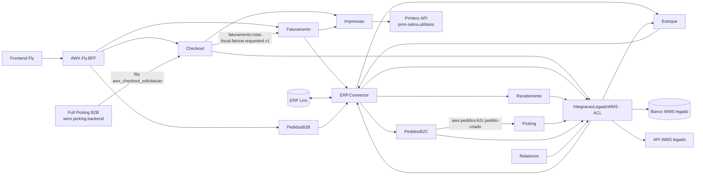

# Arquitetura atual

> **Last updated:** 2026-10-06
> **Scope:** Arquitetura as-is do AWX (`industria-logistica.wms.awx.monorepo`, commit `e495e61`) e o que este mapeamento leu de cada parte
> **Mode:** code-only
> **Status:** code-derived, not validated by a person — see ../_discovery/assumptions-register.md

IDs `C-n` e `A-n` remetem ao [índice de rastreabilidade](../_discovery/traceability-index.md) e ao [registro de pendências](../_discovery/assumptions-register.md).

## Visão geral

Monorepo .NET 10 de microsserviços de execução de armazém (C-1). São 28 artefatos implantáveis (APIs e Workers), cada um com Dockerfile próprio e um par de esteiras Azure DevOps (`-validation`/`-release`), publicados em GKE via ArgoCD (C-2). A comunicação entre serviços é por HTTP e RabbitMQ, com contratos em `src/Contracts`. Cada serviço de domínio tem um PostgreSQL próprio (EF Core + Npgsql) (C-3). O único caminho para o banco e a API do WMS legado é a ACL `AWX.IntegracaoLegadoWMS` (Dapper + SqlClient). O único caminho para o ERP Linx é o `AWX.ERP.Connector` (C-4).

Os fluxos com código de ponta a ponta são quatro: pedido B2C até o WMS legado, checkout até o faturamento, recebimento de NF de entrada e sincronização de produtos/CUP (ver `business/`). Três serviços (AgentOperacao, CrossDocking, Devolucao) são só esqueleto (C-5).

## Diagrama de contexto

## Componentes

Caminhos relativos a `src/`. "Lido" = mapeado neste run até regras e testes; os esqueletos foram lidos inteiros, porque são pequenos.

| Componente | Área | Responsabilidade | Tecnologia-chave |
|---|---|---|---|
| `Services/AWX.Checkout` (Api + Worker) | checkout | Recebe solicitações da fila, conduz a conferência e a montagem de caixas, publica o comando de faturamento, reimprime etiquetas | EF Core/Npgsql, RabbitMQ.Client direto |
| `Services/AWX.Faturamento` (Ui.WebApi + Ui.Consumer) | faturamento | Consome o comando de faturamento, chama o ERP, reconcilia até a NF autorizada, guarda e imprime etiquetas | EF Core/Npgsql, MassTransit, Polly |
| `Integrations/AWX.ERP.Connector` (Api + Worker) | conector-erp | ACL com o Linx (faturamento, status, etiquetas, contagem, auditoria, clientes, pedidos, produtos); fan-out CUP×Produto; recebimento em lote; cancelamentos B2C | HttpClient nomeado + Polly, RabbitMQ.Client |
| `Integrations/AWX.IntegracaoLegadoWMS` (Api) | integracao-legado | Lê e grava no banco do WMS legado (NF de entrada, contagem, produtos, CUP, pedidos B2C), gera identificador de volume na API do legado, consulta triangulação | Dapper + Microsoft.Data.SqlClient |
| `Services/AWX.Estoque` (Api + Worker) | estoque | Cadastro de produto, vínculo CUP→SKU e código de barras→SKU; importa do ERP o que falta | EF Core/Npgsql |
| `Services/AWX.Recebimento` (Api + Worker) | recebimento | Valida lotes de NF de entrada e repassa nota a nota à ACL; sem estado próprio | EF Core (só schema), Polly |
| `Services/AWX.PedidosB2C` (Api + Worker) | pedidos-b2c | Cria, altera e cancela pedidos B2C; outbox transacional; repassa status à ACL | EF Core/Npgsql, RabbitMQ.Client |
| `Services/AWX.Picking` (Api + Worker) | picking | Consome pedido B2C criado, registra o picking e cria o pedido no WMS legado via ACL | EF Core/Npgsql, RabbitMQ.Client |
| `Services/AWX.PedidosB2B` (Api + Worker) | pedidos-b2b | CRUD e importação CSV da parametrização por cliente; simulação de geração de demanda (placeholder) | EF Core/Npgsql, CsvHelper |
| `Services/AWX.Expedicao` (Api + Worker) | expedicao | Registra NF de expedição por HTTP ou por evento | EF Core/Npgsql, RabbitMQ.Client |
| `Services/AWX.Relatorios` (Ui.WebApi) | relatorios | Proxy síncrono da triangulação fiscal para a ACL | HttpClient + Polly |
| `Integrations/AWX.Impressao` (Api) | impressao | Monta ZPL de etiqueta de checkout e mini-DANFE e envia à Printers API | HttpClient |
| `BFFs/AWX.Fly.BFF` | fly-bff | Reverse proxy YARP com API key para Checkout, status de Faturamento e PedidosB2B | YARP |
| `Services/AWX.AgentOperacao`, `AWX.CrossDocking`, `AWX.Devolucao` (Api + Worker) | agent-operacao, cross-docking, devolucao | Esqueletos: só `/health`, DbContext sem tabelas | EF Core/Npgsql |
| `BuildingBlocks/AWX.SharedKernel`, `AWX.SharedKernel.Data` | cross-cutting | Middleware de API key, `ErrorOrResults`, `AddAwxHttpClient`/`AwxHttpClientBase`, migrations | — |
| `BuildingBlocks/AWX.EventBus.RabbitMQ` | cross-cutting | `RabbitMqConsumerBase` (prefetch 1, retry por fila com TTL, DLQ) e `RabbitMqConfigurations` | RabbitMQ.Client |
| `BuildingBlocks/AWX.ArchitectureTests` | cross-cutting | Testes NetArchTest de fronteira entre serviços e camadas | NetArchTest |
| `Contracts/AWX.Contracts.Events`, `AWX.Contracts.Integration` | cross-cutting | Eventos internos e contratos HTTP de fronteira | — |

Layout interno: Checkout, Estoque, Recebimento, PedidosB2C/B2B, Picking, Expedicao e os esqueletos seguem `Core`/`Application`/`Infra.Data`/`Infra.Bus`/`Api`/`Worker`. Faturamento e Relatorios usam `Domain`/`Application`/`Infrastructure`/`Ui.*`. ERP.Connector e Impressao usam `Core`/`Application`/`Infrastructure`/`Presentation` (C-6).

## Dados e persistência

- **PostgreSQL por serviço.** Nenhum serviço define o nome do banco em config versionada; as connection strings (`PostgreSql:DefaultConnection`, `PostgreSql:MigrationsConnection`) ficam vazias e vêm do ambiente. Os nomes `pg-<serviço>` usados no [edges.csv](../edges.csv) seguem a convenção do Atlas, não um nome real de banco `[assumption]` (A-6). Schema `public`, exceto Recebimento (`recebimento`) e Expedicao (`expedicao`) (C-3).
- **Migrations EF** aplicadas no boot fora de Development (Picking Worker aplica sempre; Checkout com `pg_advisory_lock`) (C-7).
- **Banco do WMS legado (SQL Server)**: só a ACL acessa, com duas connection strings (leitura e escrita). Os objetos novos (schemas `Recebimento`, `Produtos`, `pedido`; `dbo.ProdutosCup`) são criados por scripts SQL numerados em `Integrations/AWX.IntegracaoLegadoWMS/db/`, entregues ao DBA; não há migration automática (C-8).
- Entidades e ciclos de vida: [domain-model.md](../domain/domain-model.md).

## Pontos de entrada e runtime

- **APIs** minimal API com `Map<Contexto>Endpoints()`; todas expõem `GET /health`, exceto a `Awx.Faturamento.Ui.WebApi`, que não tem health check (C-9).
- **Workers**: consumers RabbitMQ em `BackgroundService` (Checkout, ERP.Connector, PedidosB2C, Picking, Expedicao, Faturamento via MassTransit), dispatcher de outbox (PedidosB2C, 5s) e reconciliação de faturamento (60s). Workers de Estoque, Recebimento, PedidosB2B e esqueletos só servem `/health` (C-10).
- **Mensageria**: seis filas consumidas e cinco exchanges publicadas; lista em [integrations.md](./integrations.md).
- **Entrega**: validation roda em `main`, `feature/*` e `feat/*` com filtro de paths do serviço + `src/Contracts` + `src/BuildingBlocks` + props de build; o release é disparado pelo validation de `main` e promove a imagem (C-2).

## Aspectos transversais

- **Autenticação inbound**: middleware de API key do SharedKernel (header `X-API-KEY`, valor em `ApiKey:Value`, `/health` isento) só em ERP.Connector, IntegracaoLegadoWMS, Relatorios, PedidosB2C e Fly.BFF. Checkout, Faturamento, Estoque, Recebimento, PedidosB2B, Picking, Expedicao e Impressao não autenticam (C-11, A-8).
- **Tradução ErrorOr→HTTP**: existe uma versão em `AWX.SharedKernel/Http/ErrorOrResults.cs` (NotFound→404, Validation→400, Conflict→409, demais→400), usada por vários endpoints; Checkout, PedidosB2B, ERP.Connector e a ACL ainda mantêm traduções locais em parte dos endpoints (C-12).
- **Clientes HTTP**: `AddAwxHttpClient` normaliza a base, envia `X-API-KEY` quando configurada e usa timeout padrão de 30s; o ERP.Connector tem cópia própria de `AwxHttpClientBase`; a Impressao usa `IHttpClientFactory` sem nome (C-13).
- **Consumers RabbitMQ**: `RabbitMqConsumerBase` do EventBus (retry `{fila}-retry-{N}s` com TTL e DLX, DLQ `{fila}-dlq`) é usado por ERP.Connector, Picking e Expedicao. Checkout tem uma base própria; PedidosB2C usa consumer próprio sem retry; Faturamento usa MassTransit (C-14).
- **Observabilidade**: Sentry condicionado a `Dsn`; CORS por allowlist em `Origins` (ou `Cors:AllowedOrigins`) (C-15).
- **Segredos**: só nomes e locais em [integrations.md](./integrations.md).

## Restrições e riscos

- `AWX.slnx` não inclui Picking, Relatorios nem IntegracaoLegadoWMS; `dotnet build AWX.slnx` não compila esses três (cada um tem `.slnx` próprio) (C-16, A-9).
- `AWX.ArchitectureTests` tem classe para ErpConnector, Estoque, Faturamento, FlyBff, PedidosB2C, Picking, Recebimento e duas de CUP; não há classe para Checkout, PedidosB2B, Expedicao, Impressao, Relatorios nem os esqueletos (C-17).
- Faturamento consome com MassTransit uma mensagem que o Checkout publica com RabbitMQ.Client; o acoplamento é pelo formato JSON, protegido por um teste de compatibilidade no Faturamento (C-18).
- Nomes de mensageria anteriores ao padrão `x.awx.*`/`q.awx.*` continuam em uso (`awx_checkout_*`, `awx.pedidos-b2c.*`, `iniciar-faturamento`, `awx.faturamento.pedido-b2c-concluido`); só a exchange do ERP.Connector segue o padrão novo (C-19).
- Exchange `awx.faturamento.pedido-b2c-concluido` é consumida pela Expedicao, mas nenhum código do repo a publica (C-20, A-10).
- Áreas lidas neste run: todas `full`, exceto os três esqueletos (`map only`). Nada foi validado por pessoa.
