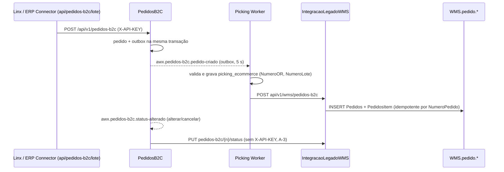

# Fluxo: pedido B2C até o WMS legado

> **Last updated:** 2026-10-06
> **Scope:** ERP Connector → PedidosB2C → Picking → ACL → banco WMS (cross-area; spec `specs/001-picking-b2c-consumer`)
> **Mode:** code-only
> **Status:** code-derived, not validated by a person — see ../_discovery/assumptions-register.md

- **Criar** é idempotente (pedido já existente devolve o existente com 201). **Alterar** sempre marca Alterado e reemite pedido-criado se vierem itens ou armazém. **Cancelar** é idempotente (C-40).
- **Picking:** pedido inválido vai direto para a DLQ; erro transitório tenta de novo em 10/30/60 s e depois vai para a DLQ. Grade e tamanho são enviados como "-" e 1 (placeholders), e NumeroOR/NumeroLote não chegam à ACL `[unverified]` (C-42, C-43, A-15).
- **Status para o legado:** falha na ACL devolve a mensagem para a fila sem limite (A-17).
- **Cancelamento externo (novo em `e495e61`).** O ERP Connector recebe em `POST api/pedidos-b2c/cancelamentos` lotes de até 500 números de pedido, publica um fato por pedido em `x.awx.erp-connector.eventos` (rk `pedido-b2c.cancelado-externamente`) e devolve, por pedido, se o barramento aceitou. Nenhum serviço do repo consome esse fato: o PedidosB2C não cancela o pedido a partir dele `[unverified]` (C-67, A-33).
- **Depois do faturamento B2C (novo).** A Expedição grava a NF do pedido (`expedicao.notas_fiscais`, status Pendente, idempotente por chave) ao receber `awx.faturamento.pedido-b2c-concluido` ou `POST api/v1/expedicao/notas-fiscais`. Ninguém no repo publica esse evento (C-68, A-34).
