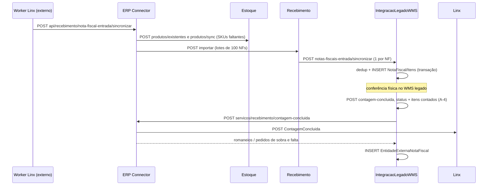

# Fluxo: NF de entrada e contagem

> **Last updated:** 2026-10-06
> **Scope:** Worker Linx → ERP Connector → Estoque / Recebimento → ACL → banco WMS, e a contagem de volta ao Linx (cross-area)
> **Mode:** code-only
> **Status:** code-derived, not validated by a person — see ../_discovery/assumptions-register.md

1. O ERP Connector garante que todo SKU da NF existe no Estoque; SKU faltante sem descrição, NCM e grade reprova a NF (`RECEBIMENTO_PRODUTO_INCOMPLETO`) (C-30).
2. O Recebimento não guarda estado: valida o lote inteiro (400 se inválido), envia NF a NF e conta importadas, já importadas (409) e falhas (C-47).
3. A ACL grava a NF no schema `Recebimento` do WMS; o recebimento legado continua lendo essa tabela (C-51).
4. Contagem: quem chama `contagem-concluida` na ACL não está no repo `[assumption]`. O INSERT dos itens contados omite colunas NOT NULL: a 1ª chamada falha depois de marcar a NF como CONCLUIDA, e a nova tentativa envia ao ERP Connector sem gravar os itens (A-4). A ACL não envia API key ao Connector (A-3).
5. **Rota do worker Linx.** Em `af25344` o Connector mantinha `api/recebimento/nota-fiscal-entrada/{erp}/sincronizar` porque, segundo o comentário no código, era a rota que `integracoes.wms.servicos-linx-wms` chama. Em `e495e61` ela foi removida e só resta a rota sem `{erp}`. Se o worker externo não migrou, a sincronização de NF responde 404 `[unverified]` (C-64, A-32).
