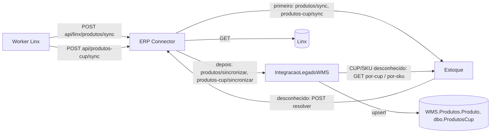

# Fluxo: sincronização de produtos e CUP

> **Last updated:** 2026-09-23
> **Scope:** Linx → ERP Connector → Estoque e ACL (fan-out CUP×Produto), e resolução sob demanda (cross-area; spec `specs/002-sku-multiplo-codigo-barra`)
> **Mode:** code-only
> **Status:** code-derived, not validated by a person — see ../_discovery/assumptions-register.md

- **Produtos:** o Estoque é a fonte da verdade; se falhar, o sync devolve 502. A cópia no WMS é best-effort. Código de barras = SKU (C-29).
- **CUP:** item a item; grava primeiro no Estoque (falha = item com falha), depois no WMS (409 = JaExistia). CUP repetido no mesmo lote = JaExistia sem chamada (C-28).
- **Resolução:** o Estoque busca local e, se não conhece, pergunta ao Linx via ERP Connector e grava. Falha ao gravar é só logada, e a resposta continua 200 `[unverified]` (C-45, A-25). A ACL faz o mesmo para o WMS nos GET por CUP/SKU.
- **Código de barras:** um código novo só entra se ainda não existe; já ligado a outro SKU é ignorado com aviso (C-45).
