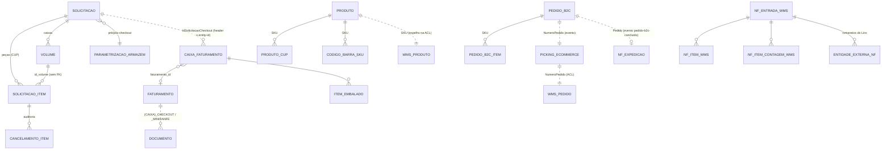

# Modelo de domínio

> **Last updated:** 2026-10-06
> **Scope:** Agregados de cada serviço AWX e as relações entre áreas (commit `e495e61`)
> **Mode:** code-only
> **Status:** code-derived, not validated by a person — see ../_discovery/assumptions-register.md

Não há chave estrangeira entre serviços: cada um tem seu banco, e as relações entre áreas passam por identificadores de negócio (caixa, CUP, SKU, NumeroPedido, IdSolicitacaoCheckout).

## Relações entre áreas

## Agregados por área

| Área | Agregado (tabela) | Atributos-chave | Ciclo de vida |
|---|---|---|---|
| Checkout | Solicitação (`solicitacao` + `solicitacao_item`) | Identificador (44), NumeroPedido (12), NomeCliente (25), CodigoBarraCaixa, status_faturamento_id; item: CUP, produto, cor, grade, conferência, cancelamento | status de faturamento `StatusFaturamentoEnum` 1–6; nulo = ainda não faturado |
| Checkout | Volume (`volume`) | Identificador (sequencial do WMS), tipo de caixa físico, tipo de caixa Linx, embalador, id_sessao_conferencia | Rascunho → Confirmado; rascunhos apagados ao abortar a sessão |
| Checkout | Sessão de conferência (`sessao_conferencia_checkout`) | solicitação, terminal, operador | EmAndamento → Finalizada / Abortada; iniciar aborta sessões órfãs do mesmo terminal |
| Checkout | Parametrização (`parametrizacoes`, `parametrizacoes_log`) | id_armazem, pré-checkout, código Linx, fechamento parcial | log jsonb antes/depois a cada alteração |
| Faturamento | Faturamento (`faturamento`) | id_faturamento (único), status, nf_saida, filial, dentro_do_prazo_cancelamento, próxima verificação, tentativas | AProcessar / EmProcessamento / Criada → Faturado ou ErroAoFaturar; NaoConfirmado após 48 h |
| Faturamento | CaixaFaturamento (`caixa_faturamento` + `item_embalado`) | caixa (não única), id_solicitacao_checkout, embalador, tipo_caixa, armazém, data de embalagem; os pedidos dos itens validam a NF devolvida | ligada a um faturamento quando o ERP aceita |
| Faturamento | Documento (`documento`) | chave (PK), tipo (Danfe, Caixa, CheckoutB2B, MiniDanfeB2B), valor jsonb | upsert por chave |
| Estoque | Produto (`produtos`), ProdutoCup, CodigoBarraSku | SKU (único), código, cor imutáveis após criação; CUP → SKU; código de barras → SKU | sem status |
| Picking | PickingEcommerce (`picking_ecommerce` + itens) | NumeroPedido (único), NumeroOR e NumeroLote por sequência | gravado antes de chamar a ACL, independentemente do resultado |
| PedidosB2C | Pedido (`pedidos` + `pedido_itens`) | NumeroPedido (único), Seller, TipoPedido, Armazém | Criado → Alterado → Cancelado |
| PedidosB2C, Picking | OutboxEvento (`outbox_eventos`) | tipo, exchange, payload, tentativas, ativo | Pendente → Publicado, ou Falhou após 3 tentativas |
| PedidosB2B | ParametrizacaoPorCliente | TipoOrdemReserva, cliente, lote, faixa de faturamento, validade, pedido franquia | soft delete; Vigente/Vencido calculado |
| Integração Legado WMS | NF de entrada (`WMS.Recebimento.NotaFiscal` + itens + contagem) | ChaveNFE, fornecedor/número/série, StatusContagem, StatusEnvioErp | contagem CONCLUIDA; envio ERP PENDENTE → ENVIADO / FALHA |
| Integração Legado WMS | Pedido WMS (`WMS.pedido.Pedidos` + itens) | NumeroPedido, IdTipoPedido, StatusPedido | projeção do PedidosB2C |
| Expedição | NotaFiscalExpedicao (`expedicao.notas_fiscais`) | Chave (44, única), Pedido, Filial, Transportadora, LojaRetirada, NumeroNotaFiscal, SerieInterna, SerieExterna | criada Pendente; EmLote, Enviada e Cancelada existem no enum mas nenhum código as atribui |

Detalhe das regras: [`../areas/checkout/rules-checkout.md`](../areas/checkout/rules-checkout.md), [`../areas/faturamento/rules-faturamento.md`](../areas/faturamento/rules-faturamento.md), [`../areas/integracao-legado-wms/rules-integracao-legado-wms.md`](../areas/integracao-legado-wms/rules-integracao-legado-wms.md), [`../areas/pedidos-b2b/rules-parametrizacao-por-cliente.md`](../areas/pedidos-b2b/rules-parametrizacao-por-cliente.md).
