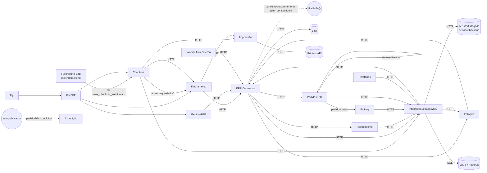

# Arquitetura atual

> **Last updated:** 2026-10-06
> **Scope:** Estrutura, subprojetos implantáveis, fronteiras e pipeline do monorepo AWX (commit `e495e61`; incremental sobre `af25344`)
> **Mode:** code-only
> **Status:** code-derived, not validated by a person — see ../_discovery/assumptions-register.md

## O que é

Monorepo .NET 10 (`AWX.slnx`, 109 projetos, versões centralizadas em `Directory.Packages.props`) com os microsserviços do AWX, que substitui aos poucos o WMS legado e se integra ao ERP Linx (C-1). As regras de arquitetura estão na constituição (`.specify/memory/constitution.md`): nenhum serviço referencia outro por projeto, o legado só é acessado pela ACL `AWX.IntegracaoLegadoWMS`, e orquestração entre contextos fica no ERP Connector ou na ACL (C-4). Testes NetArchTest em `AWX.ArchitectureTests` fiscalizam parte disso (C-5).

## Subprojetos (áreas)

Cada linha é uma área de cobertura do ledger. Nomes são os dos subprojetos no código; o agrupamento por negócio não foi validado `[unverified]`.

| Área | Caminho | Implantáveis | Papel (pelo código) | Cobertura |
|---|---|---|---|---|
| Checkout | `src/Services/AWX.Checkout` | Api, Worker | Conferência peça a peça, caixas/volumes, cancelamento, etiquetas; dispara o faturamento | full |
| Faturamento | `src/Services/AWX.Faturamento` | Ui.WebApi, Ui.Consumer | Fatura caixas no Linx via ERP Connector (B2B assíncrono; B2C síncrono, novo), reconcilia validando NF × pedido, guarda e imprime etiquetas | full |
| ERP Connector | `src/Integrations/AWX.ERP.Connector` | Api, Worker | ACL do Linx (só HTTP/AMQP, sem banco), fan-outs, auditoria e publicação de cancelamento externo B2C | full |
| Integração Legado WMS | `src/Integrations/AWX.IntegracaoLegadoWMS` | Api | ACL do banco WMS legado (Dapper) + scripts DDL; agora também da API HTTP do legado (identificador de volume) e repasse de auditoria ao ERP Connector | full |
| Estoque | `src/Services/AWX.Estoque` | Api (Worker vazio) | Cadastro local de produto, CUP e código de barras | full |
| Picking | `src/Services/AWX.Picking` | Worker (Api só health) | Recebe pedido B2C e cria o pedido no WMS via ACL | full |
| PedidosB2C | `src/Services/AWX.PedidosB2C` | Api, Worker | Entrada de pedidos B2C, outbox de eventos, status para a ACL | full |
| PedidosB2B | `src/Services/AWX.PedidosB2B` | Api (Worker vazio) | Parametrização por cliente para geração de demanda | full |
| Recebimento | `src/Services/AWX.Recebimento` | Api (Worker vazio) | Repasse de lotes de NF de entrada à ACL, sem estado | full |
| Relatórios | `src/Services/AWX.Relatorios` | Ui.WebApi | Repasse da triangulação fiscal da ACL | full |
| Impressão | `src/Integrations/AWX.Impressao` | Api | Gera ZPL e envia à Printers API (ou devolve o ZPL em modo simulação) | full |
| Fly BFF | `src/BFFs/AWX.Fly.BFF` | Api (YARP) | Proxy com API key para Checkout, Faturamento, PedidosB2B | full |
| Expedição | `src/Services/AWX.Expedicao` | Api, Worker | Registra NF de expedição B2C (HTTP ou evento `awx.faturamento.pedido-b2c-concluido`); sem consumidor da NF ainda | full (área relida em `e495e61`) |
| Scaffolds | `src/Services/AWX.{AgentOperacao,CrossDocking,Devolucao}` | Api, Worker | Só health e DI, sem domínio | map only |
| Base compartilhada | `src/BuildingBlocks`, `src/Contracts` | bibliotecas | EventBus, API key, ErrorOr→HTTP, retry; contratos de eventos e integração | full |
| Pipelines | `esteiras/` | 56 YAML | Par validation/release por implantável | map only |

## Mapa de contexto

## Padrão interno de um serviço

Layout `Core` / `Application` / `Infra.Data` (EF Core + Npgsql) / `Infra.Bus` / `Api` (minimal APIs em `Endpoints/`) / `Worker`. Faturamento e Relatórios usam `Domain`/`Infrastructure`/`Ui.*`, e Checkout, Faturamento e Relatórios têm um projeto de teste único; o próprio `CLAUDE.md` do repo registra essas divergências. Erros de negócio são `ErrorOr<T>`, traduzidos para HTTP por `AWX.SharedKernel` (NotFound 404, Validation 400, Conflict 409, resto 400). Cada serviço tem o próprio banco PostgreSQL, migrado no boot.

## Mecânicas que surpreendem

- **Mensageria sem padrão único.** Base comum com RabbitMQ.Client (DLQ, sem retry por padrão; desde `e495e61` com helpers de retry TTL usados pela Expedição), cópia divergente dentro do Checkout, retry TTL próprio no ERP Connector e no Picking, e MassTransit no Faturamento. Dois contratos novos estão pela metade no repo: o ERP Connector publica cancelamento externo B2C sem consumidor, e a Expedição consome `pedido-b2c-concluido` sem publicador (C-67, C-68). Checkout publica e Faturamento consome o mesmo exchange com bibliotecas diferentes, acoplados só pelo formato do JSON (C-6, C-11, C-12).
- **Autenticação desigual.** API key (`X-API-KEY`) em 5 subprojetos, nenhuma nos outros 7 com endpoints de negócio (a Expedição entrou sem). Desde `e495e61` o Faturamento e o Checkout enviam a chave; PedidosB2B, o Worker do PedidosB2C e a própria ACL continuam chamando serviços protegidos sem ela (C-8, C-24, C-65, A-3, A-7).
- **ERP fixado por configuração.** O ERP Connector tirou o `{erp}` das rotas e lê `Erp:Tipo`; os clientes internos foram ajustados, mas a rota `nota-fiscal-entrada/{erp}/sincronizar` do worker Linx externo sumiu (C-64, A-32).
- **A ACL escreve no legado e também versiona DDL do legado** (move `dbo.NotaFiscal` para o schema `Recebimento`, altera `dbo.PickingECommerce`). A aplicação é manual, pelo DBA (C-34, A-14).
- **Scaffolds implantáveis.** AgentOperacao, CrossDocking e Devolução têm pipeline de release mas nenhum código de domínio. Os Dockerfiles de todos os serviços mudaram em `e495e61` (imagem Azure Linux, por Trivy), sem efeito nas integrações.

## Build, testes e entrega

`dotnet build AWX.slnx`; `dotnet test AWX.slnx`. Integração com Testcontainers (PostgreSQL, MsSql, RabbitMQ). Esteiras Azure DevOps (templates `Devops.Pipeline-Templates` 4.7.0, variável `Pipeline Configs`): a validation roda build, testes e Sonar com `runBreaker`, com filtros de caminho por serviço + `src/Contracts` + `src/BuildingBlocks`. Cinco validations não filtram `src/BuildingBlocks`: faturamento-api, faturamento-worker, fly-bff, integracao-legado-wms-api e relatorios-api. A release publica imagem e aplica via ArgoCD no GKE. O ambiente de destino varia: `awx-prod` (Checkout, Recebimento), `prod` (Faturamento, Fly.BFF, Impressão, ACL, Relatórios) e `dev` (os outros 18 pipelines) (C-3, A-23).

## Onde começar a ler

- Ingestão do checkout: `src/Services/AWX.Checkout/src/AWX.Checkout.Worker/SolicitacaoCheckout/SolicitacaoConsumer.cs` → `AWX.Checkout.Application/Services/SolicitacaoService.cs`.
- Salvar checkout: `AWX.Checkout.Application/Services/CheckoutService.cs`.
- Faturar: `src/Services/AWX.Faturamento/src/Awx.Faturamento.Application/Services/ProcessarFaturamentoService.cs`.
- Legado: `src/Integrations/AWX.IntegracaoLegadoWMS/src/Awx.IntegracaoLegadoWms.Infra.Data/Repositories/`.
- Linx: `src/Integrations/AWX.ERP.Connector/src/Application/Awx.ErpConnector.Application/`.
